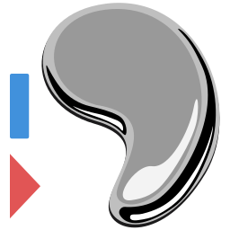

# HgInlineDiff



Mercurial editor change markers, Solution Explorer status icons, and a changes window.
For Visual Studio 2022 and 2026 on Windows x64.

[Download the VSIX](https://github.com/den4md/HgInlineDiff/releases/latest) · [Report an issue](https://github.com/den4md/HgInlineDiff/issues) · [MIT license](LICENSE.txt)

## Install

1. Download and install [TortoiseHg for Windows](https://tortoisehg.bitbucket.io/download/).
   It includes the Mercurial command-line client. A standalone Mercurial installation also works.
2. Open a new terminal and run `hg --version`. If the command is not found, add the directory containing
   `hg.exe` to PATH, usually `C:\Program Files\TortoiseHg`, and check again in a new terminal.
3. Close all Visual Studio instances. Download `HgInlineDiff.vsix` from
   [GitHub Releases](https://github.com/den4md/HgInlineDiff/releases/latest), open it, and select the installed Visual Studio versions.
4. Start Visual Studio and open a tracked text file in a Mercurial working copy.
   HgInlineDiff activates its Source Control provider automatically for Mercurial solutions.

HgInlineDiff keeps the extension ID used by earlier development builds named HgVS Mercurial Margin.
Version 0.2.0 updates earlier versions in place. Do not install both packages as separate extensions.

## Use

Edit a file to see green additions, blue modifications, and red deletion triangles beside its lines.
The scrollbar shows the same changes throughout the file.
Click a marker to view the parent revision's text with the file's language highlighting.
Select and copy with Ctrl+C or the context menu; press Escape to return focus to the editor.

Unsaved editor changes update after a 350 ms pause. Snapshot text and differences are calculated in the background;
each view runs one comparison at a time and discards superseded results. Marker layout uses only the editor's
existing visible lines, without formatting offscreen lines. The parent text is cached when a file is opened.
The last completed markers stay visible while their replacement is calculated. The scrollbar shows the same
green additions, blue modifications, and red deletion marks, using the editor's scroll map in both bar and map mode.
After an external commit, update, revert, add, or rename, use **Tools > Refresh Mercurial Changes**.
The same command is available by right-clicking the Mercurial margin.
It refreshes all open Mercurial margins, without saving or changing any files.
Assign a shortcut under Tools > Options > Environment > Keyboard using `HgInlineDiff.RefreshMercurialChanges`.

### Solution Explorer and changes window

Solution Explorer shows a green dot for clean files and folders, a red dot for modified files and folders,
and `+`, `×`, `!`, or `?` for added, removed, missing, or untracked files. A folder becomes modified when
any file below it changes, including files outside the project. Ignored files have no status icon.
HgInlineDiff takes priority as the Source Control provider when a Mercurial solution is detected.
Remove VisualHgMod2 if it is installed to avoid competing automatic provider selection.

Open **View > Other Windows > HgInlineDiff: Changes** for a list of changed files throughout each
repository containing the solution or one of its loaded projects. The list includes modified, added,
removed, missing, and untracked files, including binary files and files outside the solution.
It is sorted by repository-relative path and shows only Status and Path, plus Repository when more
than one repository is present. Renames appear as removed and added paths; copies appear as additions.

Click a row to open a preview tab. Double-click or press Enter to keep the tab open.
Missing files do not open. The window has no filter, checkboxes, or repository editing commands.
Its Refresh button also refreshes the existing editor margins.

Statuses describe saved files on disk. They refresh in the background after saves and filesystem events,
with a 500 ms debounce, and when Visual Studio regains focus. Unsaved text continues to appear in the
editor's line markers. A failed refresh preserves previous results and displays an error in the window.
Source Control icon requests read the cache without running Mercurial on the UI thread.

The baseline is the working copy's first parent, not the repository's newest changeset.
Added tracked files are compared with empty text. Untracked, ignored, and binary files are skipped.
Copied and renamed files use the source path from Mercurial's copy metadata.
Line-ending conversions are ignored; other whitespace changes are shown.

## Requirements and limits

- Text up to 4 MiB from Mercurial and 2 million UTF-16 characters in the editor.
- Projection editors, such as embedded language views, are skipped until buffer mapping is implemented.
- Colors are configurable under Fonts and Colors as `Mercurial added/modified/deleted lines`.
- Filename support follows the installed Mercurial client. Older Windows clients may require filenames representable in the Windows ANSI code page.
- Popup highlighting uses the file's content type and VS classifiers. The complete parent file supplies context, while the popup exposes only the changed fragment. C# and Visual Basic previews register a separate Roslyn document in a temporary workspace. Other files and project references come from the current solution.

## Troubleshooting

- **No markers outside Mercurial:** this is expected. Files outside a directory containing `.hg` do not start the Mercurial client.
- **Mercurial is missing:** inside a working copy, the margin tooltip reports that `hg.exe` could not start.
  Install TortoiseHg, check PATH, restart Visual Studio, and use **Tools > Refresh Mercurial Changes**.
  There is no retry loop while typing; opening another file or refreshing attempts to load its baseline again.
- **Markers still use the previous commit:** refresh after committing or updating outside the editor.
  Refresh also finds repositories created after a file was opened.

## Build

Use Visual Studio 2026 with the **Visual Studio extension development** workload and .NET Framework 4.7.2 targeting pack.
Open `HgInlineDiff.slnx`, restore NuGet packages, and build. Building uses the VS 2026 compiler; the resulting extension targets VS 2022 APIs.
Press F5 to try it in the Visual Studio Experimental Instance.

For a Visual Studio 2026 Enterprise installation:

```powershell
& 'C:\Program Files\Microsoft Visual Studio\18\Enterprise\MSBuild\Current\Bin\MSBuild.exe' HgInlineDiff.slnx /restore /p:Configuration=Release /p:DeployExtension=false
```

The package is under `HgInlineDiff/bin/Release/net472/HgInlineDiff.vsix`.

## Checks

Run `tests/Run-SmokeTests.ps1` to exercise the actual Visual Studio differencing service and a temporary Mercurial repository.
The script needs Visual Studio and TortoiseHg; it downloads no test framework.
Pass `-VisualStudioPath` to check another installed IDE version.
Fixtures and the compiled test executable stay in the ignored `work/` directory.

The checks cover line markers, old text, EOF deletion, whitespace, encodings, added and renamed files,
parent-versus-tip behavior, refresh after commit, and cancellation. WPF regressions also check marker reuse,
stable layout, large changes outside the viewport, preservation of markers during recalculation, and interception
of clicks before the built-in selection margin. Popup checks exercise Escape through WPF and the shell command
target, shell Copy, focus scoping, read-only input, and disposal. Scrollbar checks inspect the rendered colors.
Roslyn checks classify parent-text fragments in C# and Visual Basic, verify keywords, strings, comments,
imported types, parameters, and locals declared outside the fragment, and check source-document isolation
and preview-workspace disposal. Popup checks verify that only the hunk is exposed, including CRLF parent files,
repeated fragments, and deletions; addition messages remain unchanged.
Queue checks cover debounce, background snapshot reads, cancellation, and serialization of a slow differencing engine.
Status checks use temporary Mercurial repositories and real WPF controls with substituted shell interfaces.
They cover all five change statuses, binary and non-project files, ignored files, renames, copies,
recursive folder aggregation, multiple repositories, batched glyph requests, 64-bit image list handles,
path sorting, selection preservation, filesystem/save/activation refresh, recovery after failure,
cancellation on solution close, and shell event unsubscription.
Placement, language coloring, and interaction with CodeLens still require a manual check inside Visual Studio.
Solution Explorer glyph placement and preview-tab interaction also require an in-IDE check.

The editor integration is adapted from Git Diff Margin. See THIRD-PARTY-NOTICES.md and LICENSE.txt.
